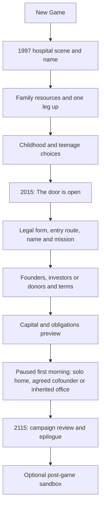

# Campaign flow and founder introduction

Design baseline 1.3 · 2026-11-07 · Setup implemented; later stages remain design

This expands the user's campaign/opening feedback. It supersedes the old
2014–2114 default and four-background setup in the product design. The Mac New Game path implements the introduction and founding setup. Older
prototype presets remain engineering fixtures. Later gameplay stages and
ending presentation are future work. [Technology design](TECHNOLOGY.md)
and the [candidate catalog](TECHNOLOGY_CATALOG.md) supply the research side.
The main-game layout is the next discussion; this document specifies information
and atmosphere it must support without selecting a new screen arrangement.

## The player's role

**New Game** starts the founder campaign with a California birth in 1997.
The first playable company day is in 2015, when the founder turns 18.
Standalone sandbox creation was removed from setup. Post-game continuation
is an option from the campaign's completed review.

The player remains connected to the founding character throughout the campaign,
even if another person becomes CEO. Delegation, retirement, chairmanship and
institutional representation can change daily responsibilities and control;
they do not kill the founder or replace the player's biography. Guaranteed
campaign longevity to 118 is a declared premise, independent of athletic traits,
medical research, random incidents or retirement. Institutional failure can
still end a run early with its own review and continuation options.

## Calendar and the campaign boundary

Use **1997-01-01** as the initial authored birth date, **2015-01-01** as the
18th-birthday company start and **2115-01-01** as the 118th-birthday ending.
These exact days are design defaults, not extra identity questions. This gives
18 years of narrated introduction and exactly 100 years of company play.

Settle the final playable day, 2114-12-31, then close the campaign before any
2115 opening work, deliveries or research execute. Freeze objective results
and the historical snapshot. The concluding narrative covers the founder's
passing at 118, the company's subsequent direction and different audiences'
reactions. Its future passages are conditional epilogue projections, clearly
separate from recorded simulated facts.

An ASI-race result can be secured or lost earlier; show that dated result and
continue the campaign to 118. Do not force an early ending for success. A player
may voluntarily end or leave the game at any point. In post-game, institutional
leadership continues; any playful founder-longevity Easter egg cannot rewrite
the completed campaign's ending.

The [2026-11-09 selected refinements](FEEDBACK_REFINEMENTS.md) supersede the
earlier setup assumptions below. Starting conditions determine challenge; there
is no difficulty choice. Hiring, premises shopping and experiments belong in play.

## Opening sequence

### Identity and temperament

Open on the illustrated maternity ward in California in January 1997. Let
the birth narration settle before asking for the first name. Ask for each
answer on its own beat. Childhood choices express sociability, activity and
decision-making through scenes. Gender and pronouns have separate beats when
the founder prepares for a public demonstration.

Use a fitted canvas with silhouette art behind the text. Family background and
legal form set the art and accent on later beats. Keep every visible action
within the canvas, with no scrolling. Animate the heading, narration and
decisions in sequence. Let the player reveal a beat immediately or use reduced
motion. Use the main menu's Resume action for a saved place in the prologue.
The world seed can be edited from the signing review.

### Family and one leg up

First choose poor, middle-class or rich parents. This sets resources, school
access, social contacts and the texture of scenes, not inherent ability or
virtue. Then choose exactly one exceptional advantage:

| Leg up | Availability | Opening distinction | Tradeoff and later relevance |
| --- | --- | --- | --- |
| Actual Genius | Every family background | Can perform the first qualified research assignment personally; unusual technical entry offers | Founder time is finite; research competes with fundraising and leadership |
| Extremely Charismatic | Every family background | Better access to meetings, recruitment and persuasive pitches | Claims need evidence; reputation damage can be larger after an unsupported promise |
| Wealthy Elite | Rich parents required | Larger accessible founder contribution and elite commercial network | Separate personal funds from company funds; expectations and concentration risk |
| Child of Political Elite | Every family background | Political/institutional contacts; family becomes wealthy by age 18 | Disclosed conflicts, scrutiny and family expectations; no guaranteed votes or immunity |

“Child of Political Elite” is the gender-neutral display label for the user's
“Son of Political Elite.” Its family rise occurs during the introduction and
is recorded as events; a poor starting childhood remains part of the history.
Rich families can self-fund without selecting Wealthy Elite; that leg up adds
scale/access rather than being the only permission to use family capital.

Every combination needs at least one viable startup route. Genius is exceptional
research capacity, not free compute, data, salaries or universal expertise.
Other founders can learn, collaborate and hire; they are not barred from science.

### Childhood and adolescence

Target 8–12 meaningful decisions across a short, readable introduction. The
following are scene seeds, not finished dialogue or an instruction to copy
Suzerain's scenes, prose or presentation. Borrow the idea of a formative life
history with time passing between consequential choices.

| Chapter | Situation and choices | Retained consequences |
| --- | --- | --- |
| Ages 0–5, 1997–2002 | Family work, moves and access to an old computer; early care arrangements | Home circumstances, relatives and continuity; an infant does not make adult strategic decisions |
| Ages 6–9, 2003–2006 | First programming/creative project, sport, library club or neighborhood group | Interests, one early contact and a small skill tendency |
| Ages 10–12, 2007–2009 | Family meets an economic setback or opportunity; share equipment, seek a scholarship or organize help | Family resources, a promise and attitudes toward access; no forced traumatic scene |
| Ages 13–14, 2010–2011 | Join a science team, community group, small business or public-policy activity | Technical, commercial or civic network; collaboration history |
| Ages 15–16, 2012–2013 | A project shows real promise; reproduce the result, chase attention, share methods or seek a sponsor | Evidence, publicity, ownership expectations and a future contact |
| Age 17, 2014 | School/lab placement, competition, part-time venture or a public demonstration; confront an overstated claim | Dated record, recommendation, reputation with specific audiences |
| Age 18, 2015 | Review offers and choose how to enter an AI startup | Founder role, partners, financing possibilities and starting responsibilities |

Use age-appropriate choices: early chapters may describe family decisions and
let the player choose the background, rather than pretending a baby directs
the household. Context varies with family and leg up. At least one later
callback should acknowledge each major selected thread. Most flags flavor text;
only selected choices affect mechanics, with bounded deltas and visible reasons.

Record the scene ID/revision, date/age, choice, selected outcome, involved people,
claims/promises, visibility, and resulting resources/traits. Keep public and
private facts separate. News can cite a public teenage science award; a rival
cannot know an undisclosed childhood conversation. A school contact can later
become an applicant, investor introduction or critic, with its own agency.

Allow save/resume, review and Back within the uncommitted introduction. Replaying
a scene after changing an earlier choice recomputes its dependent results;
it never stacks rewards. Changing identity alone does not reroll an outcome.
Offer “Use a prepared biography” with a complete review for repeat players.

### Startup entry at 18

| Route | Example availability | Actual starting situation |
| --- | --- | --- |
| Wealthy sole founder | Wealth at eighteen | Alone at parents’ house/garage, $0 rent; no outside backers |
| Investor-backed founder | Solicit and accept at least one named offer | Alone at home, signed equity funding; hire and find premises during play |
| Cofounding partnership | Agreed contribution and ownership terms | A founding partner, shared premises and disclosed payroll/rent |
| Hired CEO | Accept the existing company's employment terms | Existing rented office, three employees and company cash; 5% employment grant |
| Mission-funded founder | Solicit and accept a named nonprofit gift | Alone at home; institution owns the assets; no automatic trust/endowment |

None of these routes starts a research project or supplies a finished product.
Family resources and the selected route determine the opening, without difficulty
multipliers. The main-game property, hiring and research milestones complete the
first operating loop.

### Company, mission, charter and capital

Choose company name, founding mission and organizational form before committing
funding. Mission selects the scored objective, while charter sets real initial
promises and governance constraints. Show exact objective rules before confirmation.

| Example mission | Primary objective | Important compatibility |
| --- | --- | --- |
| Build the world's leading AI platform | World Monopoly | Useful delivered work, including defined license attribution |
| Become the institution that steers the AI age | World Domination | Enforceable authority, not popularity or ordinary sales |
| Make advanced AI improve life broadly | World Utopia | Distributed real outcomes and sustained final-decade conditions |
| Create an enduring financial legacy | Profit | For-profit ownership route; nonprofit assets are not founder wealth |
| Be first to independently demonstrate ASI | ASI Race | A scenario with a feasible route; early result retained to the ending |
| Build a lab that lasts | Simple Survival | A real operating institution; nonprofit and specialist routes eligible |

The six objective families remain; mission wording supplies narrative identity,
not six new incompatible scoring engines. Changing a mission's wording is
cosmetic. Changing its primary objective during play labels the run custom;
amending charter promises uses governance and can affect public perception.

For-profit corporations have equity holders and negotiated board/financing
rights. A nonprofit has donors, grantors and trustees rather than saleable
founder equity, dividends or ordinary VC equity rounds. Nonprofit incorporation
and tax-exemption recognition are separate states. Setup may offer a recognized
eligible research-lab package, with its mission restrictions disclosed. Exemption
applies to eligible income; payroll obligations, other applicable taxes and
taxable unrelated business activity can remain. Use dated, simplified authored
tax profiles, not a claim of real tax-filing accuracy or live law updates.
[IRS recognition](https://www.irs.gov/charities-non-profits/application-for-recognition-of-exemption)
and [unrelated business income](https://www.irs.gov/charities-non-profits/unrelated-business-income-defined)
support this distinction.

Preserve the user's nonprofit goodwill advantage as a bounded bonus to
**eligible, observed mission-serving actions** among relevant audiences.
The same action by a for-profit can earn a smaller gain. A nonprofit label
does not automatically make research sound, misconduct acceptable or every
audience favorable; mission violations can destroy the benefit. Profit missions
are unavailable for a pure nonprofit, with an explanation and compatible
alternatives. Any later conversion/subsidiary structure needs asset protection,
governance approval and separately designed accounting, not a tax toggle.

### Funding cast and first commitments

Offer a small premade fictional cast; select how many backers to approach and
which terms to accept. Suggested archetypes are starting motives, not guarantees
or ideological character classes:

| Backer | Priorities and possible terms |
| --- | --- |
| Frontier enthusiast | Ambitious milestones and a large research budget; patient about current revenue, impatient about technical progress |
| Acceleration advocate | Faster deployment and broad access; negotiates publication/release expectations |
| AI safety philanthropist | Independent evaluations and mission restrictions; grants/donations for eligible nonprofits, compatible investment offers for firms |
| Commercial operator | Margins, customer proof and reporting; realistic dilution and board requests |
| Open-science foundation | Reproducibility, publication and access commitments; restricted funding rather than nonprofit equity |
| Strategic compute partner | Credits, capacity or cash with expiry, exclusivity and supplier dependence |

All can decline or counteroffer within their actual budgets. Prestige, public
buzz, credible evidence, personal contacts, mission fit and market conditions
affect access and terms; none creates money automatically. Separate a supporter
who makes an introduction from a signed investor, donor, creditor or supplier.

Compute opening unrestricted spendable cash from **paid founder contributions + settled
investments + usable unrestricted grants/donations − paid formation costs**.
Restricted cash reconciles with the total bank balance and its permitted uses;
undrawn debt and expiring compute credits appear separately from cash.
Record personal-source limits, conserved ownership, board seats, grant uses,
recurring obligations and dates. No simultaneous unlimited cash and control.
Review contributions, formation costs, opening cash, ownership, rent, payroll,
founder salary and actual equipment before signing. Opening research compute is
zero until the player acquires a real source. The founder brings their disclosed
personal phone/laptop; an inherited shared office includes a workstation. The
pending equipment/compute milestone will connect physical machines to their
measured capacity.

Do not choose an office, hire a first researcher or select the first experiment
in setup. Start paused in the premises determined by the entry route. A genius
can contribute their own working capacity; other solo founders have no research
staff until they recruit during play. Property and recruitment decisions must
use their actual main-game systems, with costs and terms the player can review.

## Broad gameplay stages

Use a persistent **industry stage** plus a separate **company development stage**.
The first qualifying chatbot may belong to a rival; a specialist or nonprofit
still experiences the resulting market and social changes. Neither stage is a
technology-era number or an objective score. Save transition dates and causes.

Thresholds below are provisional content defaults for testing. Use sustained
observations and separate entry/exit thresholds; do not flip the whole experience
because of one noisy month. Major transitions occur once, while overlays such
as funding crises can recur under their own bounded rules.

| Stage | Entry/cause | Main decisions and consequences |
| --- | --- | --- |
| Setup | New campaign through a valid first morning | Biography, opportunity, charter, backers, capital, office and first research capacity |
| Early game | Company start, normally before broad conversational adoption | Burn runway on evidence, choose research bets, publish/license, recruit and raise funds; no prebuilt general assistant |
| Boomtown | Any public commercial chatbot passes the capability/reliability/service gate and its adoption gate | Rapid interest and potential demand, funding attention, scaling, incidents and rival entry; customers still require finite budgets and capacity |
| Maturing | Sustained demand deceleration, established competitors and deployed controls with measured incident reductions | Reliability, unit economics, access and implementation standards; useful safety improvements work within tested coverage |
| Profitability / nonprofit crisis | Conditional company overlay when funding, charter and obligations diverge | Revenue and margin discipline, grants/mission continuity, lawful partnerships, restructuring or closure; preventable with planning |
| Midgame | Established operations and broad market saturation; stage can also follow a long specialist/plateau path | Retention, incremental gains, long research horizons, diversification, governance and capital allocation |
| Late game | Mature large institution or a late-life durable smaller institution | Manage the empire or chosen niche, infrastructure replacement, institutional power, succession and founder legacy |
| Post-game review | Age-118 boundary, or an earlier genuine terminal outcome | Dated objective result, history, world consequences, epilogue and charts |
| I want more | Explicit choice from completed review | Same systemic world in an unscored post-game sandbox |

An initial boom gate could require a general conversational service with
independent language competence ≥65/100, measured reliability ≥70/100, a usable
distribution channel, 30 consecutive days of actual service and at least 100,000
monthly active users for two monthly reviews. These are fictional design values,
not measured historical thresholds. Separate active users, tasks and registered
accounts; do not convert tasks into unique people without a population model.
Supply an authored enterprise-adoption equivalent for worlds without a consumer
channel. A public demo, paper or launch press release alone does not trigger it.

Potential demand can expand quickly after the gate, but delivered growth still
needs customers, distribution, affordability, compute and support. No instant
millions of billable users. Rival breakthroughs can open demand without granting
the player their method or their customers.

Maturing should use at least four quarterly reviews of slowing adoption growth,
recurring customer relationships and demonstrated control coverage. “Safety is
working” means specific deployed measures have evidence of reducing relevant
failures, not that all AI is safe. Later capabilities can create new exposure.
Midgame saturation is segment/region-specific; underserved markets still exist.

The profitability/nonprofit crisis is an overlay, not a compulsory chapter or
a penalty for legal form. Warn from forecasts and expiring commitments. A
nonprofit can sustain grants, donations and mission-related earned revenue;
a for-profit can plan margins and runway. Neither is forced to convert or betray
its mission. Decline, plateau, acquisition and recovery stories fit the same
stages. If no qualifying chatbot ever emerges, skip Boomtown and explain the
alternative industry history; later founder-life and institutional stages still
reach an ending. Never require an impossible milestone to finish the campaign.

Office art reflects calendar period, company scale and selected building, using
a modest reusable set with variations. A struggling 2070 lab need not occupy a
palace, and an early successful lab need not have futuristic equipment. Stage
changes can alter narrative emphasis and information priorities. The actual
main-game layout, room arrangement and stage-specific controls remain open.

## Campaign review and optional continuation

The review combines the founder's history, company record and regional world
outcomes. Reactions from staff, researchers, customers, investors/donors,
regulators and communities can disagree. Use actual promises, public actions,
delivered benefits and harms; avoid a single narrator-assigned moral grade.

Include charts/tables for cash, burn, revenue/profit, financing and founder stake;
research spending, discoveries, publications, adoptions and prestige; products,
active users and useful tasks; incidents, reliability and service access; staff,
sites, compute and energy; competitors, regional welfare/authority and objective
progress. Distinguish actual observations from unavailable data. Preserve major
events and dates, monthly aggregates and older annual summaries without keeping
all daily history or inventing unrecorded statistics. Data stays local.

Epilogue passages say what the founder left behind, how the company could carry
on, and what kind of world their actions helped create. They must distinguish
historical facts from narrative projections. A sandbox continuation starts from
the **actual saved boundary**, rather than simulating the epilogue's projected
decades or resetting finances, commitments, rivals or knowledge.

Create a protected completed-campaign snapshot before offering **I want more**.
Continue into a distinct sandbox state/save with the original result attached.
Campaign rewards and final windows cannot be farmed or revised there. Core
markets, research, incidents, rivals and repeatable improvements keep running;
campaign-only chapters stop. The interface says the campaign story is complete.
A few optional Easter eggs may exist without promising another authored era.

## State, integration and implementation handoff

| Owner | Required additions or adaptation |
| --- | --- |
| Setup/session | Draft biography and choices, eligibility, funding previews, idempotent finalization and paused first morning |
| Core people/governance | Founder identity/birth date/life boundary, temperament, qualified finite work, family/contact history and role transitions without forced founder death |
| Accounts/corporate | Personal contributions, investor versus donor terms, restricted funds, nonprofit ownership constraints and dated tax profiles |
| Lab/market | No ready general product; prestige versus buzz; measured adoption and control outcomes for stage gates |
| Runtime/content | Original childhood scenes, callbacks, opportunity offers, typed stage facts, transition receipts and conditional epilogue templates |
| Persistence/history | Mid-introduction saves, choice/outcome receipts, provenance/visibility, stage observations, frozen campaign outcome and separate sandbox continuation |
| Presentation | Identity grammar, preview/review controls, first office art, milestone explanations and accessible ending charts; layout discussion still pending |

Use the existing transaction/flow runtime and registries. A childhood screen is
a content presentation with typed setup effects, not a second interpreter.
Preserve historical saves under their original scenario/rules. Implement the
new default as a versioned scenario/rules change; never shift every old date by
one year, reset objective windows or rewrite old founders into the new biography.

Before claiming implementation complete, exercise a poor charismatic nonprofit
route, a rich self-funded route, a genius personally doing research, and a
political-family rise. Verify blocked choices explain themselves, every offered
package can start, Back cannot multiply capital, public/private callbacks are
respected, stages can be reached/skipped, retirement preserves the founder,
and age-118 save/reload/continuation freezes the same result exactly once.

## Deferred tutorial TODO

**TODO, after gameplay and the main-game layout are finalized:** create the
actual tutorial using the final campaign mechanics, offer it on first play,
allow Skip and replay from Help/Settings, and check every founding route and
accessibility mode. Do not script or claim the finished tutorial now. The
prototype's existing guide is temporary; the narrative introduction supplies
the character's history and does not substitute for teaching the game.
