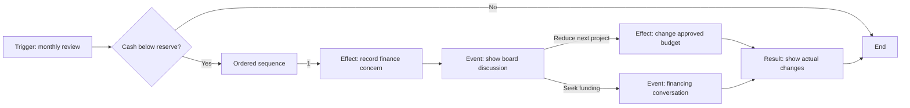

# Content Studio — graphical repository authoring

Planning baseline 1.2 · 2026-11-03 · Design specification; no editor is implemented yet

## 1. Purpose and product boundary

Build **Glowing Pancake Content Studio**, a separate offline desktop application for human authors to create, inspect, organize, test, and maintain the game's repository content. The game also includes built-in systemic events and AI-assisted development content; humans enrich that baseline with stories and creative decisions. The tool makes conditions, targets, consequences, and mistakes visible and provides the same validation path for all origins. Editing ordinary content must not require hand-written scripts, JSON, or a programming background.

The Studio is available as its own download and as source in this repository. It opens an explicitly selected development checkout and edits the canonical content there. The base game contains neither the editor nor its editing interfaces. This is a production authoring tool, not a player mod manager, Workshop client, or way to modify an installed game. Release packaging creates the game's validated content from reviewed repository data.

The user's references are conceptual: Clausewitz-style triggers/effects, Plague Inc.'s visually separated content areas, and linked boxes as in URLAlchemist or Blender nodes. They do not prescribe another product's syntax or interface. Plague Inc.'s official guide demonstrates grouped content areas; we adopt discoverability while designing our own workflow. [Ndemic's guide](https://www.ndemiccreations.com/en/news/194-plague-inc-scenario-creator-the-basics). URLAlchemist's supplied local source was inspected for its categorized blocks, typed connections, workspace navigation, and grouped branch layout; none of its build instructions were executed and no source was copied.

## 2. The central model: triggers → effects and events

A **content flow** binds a trigger and lifecycle to an ordered graph. It can change permitted game state, show news, open a conversation, schedule another event, or maintain a temporary modifier. A trigger can lead to several effects/events. Dialogues are one use of the graph, not the whole authoring system.

| Element | Author's question | Graphical representation |
| --- | --- | --- |
| Trigger | What starts this, and under which conditions? | Trigger box with scope, signal/calendar anchor, and nested conditions |
| Scope/target | Which company, region, person, site, product, or project? | Named typed binding and entity selector; visible on relevant nodes |
| Condition | Is this true? All, any, not, comparison, duration? | Condition box with clearly labeled true/false exits |
| Effect | What changes, where, and by how much? | Effect box with target, operation, amount, unit, and timing |
| Event | What does the player see? | News or dialogue box referencing reusable authored text/assets |
| Choice/result | What can be chosen, and what actually happened? | Labeled buttons/branches leading to explicit result boxes |
| Delay | When does the next step become due? | Simulated-day/calendar delay with due-date preview |
| Sequence | In what order do several actions run? | Numbered outputs; fan-out is ordered, never implied concurrency |
| End | Is this execution segment complete? | Explicit terminal box; continuous instances remain active until lifecycle exit |

Simple flows are simple: one trigger linked to one effect or news item. Larger flows can use nested conditions, several effects, reusable event templates, delayed consequences, and dialogue branches. A reusable event presentation has no independent automatic trigger; its incoming flow supplies context and activation. A scheduled follow-up explicitly creates a new activation. This avoids the same event firing both from its own timer and from an incoming link.

The registered vocabulary also supports scoped story flags/typed variables, bounded arithmetic/value comparisons, related-entity selectors, any/all/count matching, “holds for N days” predicates and explicitly weighted random branches. This supplies expressive systemic authoring within the game's available concepts. Selected collections are traversed in stable order; bindings and selected-target counts are inspectable. A shared variable has a named scope/default and cannot accidentally become a global flag. Random branch weights, source stream and resolved outcome are visible in the test trace; reopening a result does not draw again. Unavailable engine operations require a registry/core extension rather than a free-form script escape hatch.

Duration help must explain elapsed-day boundaries, the last daily observation
and any reset. First true on D satisfies N days on D+N. Timers sample the opening
snapshot before content effects and retain it through choices. Exit timers
measure scope history before entry and across reentry, rather than the age of an
activation. Author fixtures show saved start/elapsed/result alongside current
fact values; missing sampling context is unknown. Player views redact hidden
history. The shared [daily contract](SIMULATION_SPEC.md) governs these meanings.



The diagram illustrates structure, not an already implemented scenario. A decision creates only the commitments stated by its effects; opening financing does not silently sign a financing deal.

## 3. Presentation and lifecycle are independent

Presentation is **news**, **dialogue**, or **hidden logic**. News supplies a bulletin/inbox item; dialogue supplies text and one or more buttons, with a result shown after the choice resolves; hidden logic applies authorized effects without a player window. Hidden logic remains visible and traceable in the Studio. A hidden flow may explicitly schedule a later visible event.

Timing is configured separately:

| Lifecycle | Meaning | Required author controls |
| --- | --- | --- |
| Once | First eligible activation, then exhausted for its occurrence scope | Once per world/company/site/etc.; optional expiry |
| Recurring | Can activate again according to an explicit re-entry or cooldown rule | Re-entry versus still-eligible retry, cooldown, maximum occurrences, overlap policy |
| Interval | At anchored simulated daily/weekly/monthly/yearly or N-day boundaries | Anchor, interval, eligibility at due time, end date; skipped checks are not backfilled |
| Scheduled | At a fixed game date or a delay from another flow | Due date/delay, eligibility, explicit skip or wait-until-expiry policy |
| Continuous | Active while conditions hold, with entry/exit behavior and owned modifiers | Entry/exit conditions, duration/expiry, optional bounded periodic action, stacking rule |

“Continuous” means a persistent simulation condition evaluated at defined boundaries, not a busy loop. Recurrence never means once per rendered frame. Per-scope occurrence counts, cooldowns, pending instances, and active state survive save/load. The UI reads these settings as a sentence: “On the first monthly review where this company's cash is below its reserve, once per company.”

Continuous modifiers have an owner and a stable key. Entry registers the modifier once; exit removes that modifier and recalculates the effective value. Do not undo a percentage change by applying an opposite percentage or repeatedly mutate the base every day. Hysteresis/exit thresholds and overlap rules prevent chattering and accidental stacking. Finite repeated costs or actions require an explicit interval and resource validation.

## 4. Studio layout and current-content management

Use an original three-pane workspace, with persistent project/version status and clear **Browse**, **Build**, **Test**, and **Review changes** stages:

```text
Project / branch / versions       Save draft | Validate | Test | Finalize revision
Content library     | Graph, form, or table workspace | Selected-box settings/help
Search and filters  | Trigger -> Condition -> Effect  | Target, units, timing
Current definitions |             \-> Event -> ...    | Reference and usage details
--------------------+--------------------------------+----------------------------
Problems / trigger trace / before-after changes / affected targets / change summary
```

The library shows the content already in the selected checkout and all draft content. Categories include Events & flows; Scenarios & objectives; Research & model recipes; Datasets; Hardware & sites; Markets & products; People & rivals; Policies & world profiles; Text/localization; Assets & credits. E1a delivers slice categories with complete forms/outline and impact inspection before gameplay tests. E1b adds the required node canvas and graphical batch finalizer on that same document model before M4. E2 adds broader systems as their schemas become available. The layout below specifies the completed Studio, not an E1a canvas prerequisite.

Search by title, stable ID, text, tag, content type, presentation, lifecycle, scope, era/region, status, validation problem, and revision. Tables show status, references, revision and warnings. Opening an item selects its graph/form and highlights where it fits. “Used by” and “Uses” follow references in both directions. A filtered view can list all recurring events, all hidden logic, all dialogue awaiting text, or all flows affecting a chosen value.

Provide create-from-template, duplicate with new IDs, rename display title, explicit ID refactoring, enable/disable, compare revisions, bulk tag, and safe delete. Deletion lists affected references and blocks dangling links; replacement/refactoring updates references as one reviewed change. Never confuse two similarly named events: show both display title and stable ID at links, search results, previews, and replacement dialogs. Existing manual edits are first-class repository content, not a separate lower-quality import path.

Built-in baseline rules and AI-assisted repository definitions are equally browsable, editable and inspectable. Show their source occurrence dependencies and whether a story replaces a baseline presentation or schedules a follow-up, so authors can catch a duplicated consequence. E1a manages/finalizes the eight-flow [playable baseline](EVENT_SYSTEM.md); the game does not need a human to create each occurrence manually. Runtime AI and live news ingestion are outside this tool/game boundary.

Draft definitions can be saved under `data/drafts/` and committed for collaboration; they are excluded from playable content. An invalid draft stays a draft and shows problems. Reviewed content cannot enter a release pack with errors. The library distinguishes enabled, disabled, draft, deprecated, and invalid definitions without relying on color alone.

## 5. Node interaction and author help

Use a searchable node palette, drag/drop or keyboard creation, typed labeled ports, fit-to-selection, pan/zoom, a searchable node navigator, collapsible groups, bookmarks, comments, undo/redo, copy/paste with ID repair, and automatic layout. Grouped branches move together; shared continuations are visible. Links identify true/false, choice labels, delayed routes, and execution order. Warn about crossings/overlap without changing logic to improve appearance.

Use different port types for execution, booleans, entities, money, rates, durations, and other values. Reject incompatible links; do not silently treat a number as true/false, dollars as cents, a region as a company, or a percentage as an absolute amount. Selection/target wiring must preserve context through branches and delayed steps. Reusable subflows have named typed inputs/outputs, explicit return behavior, versioned references, and bounded expansion; uncontrolled recursion is unavailable.

Numbered fan-out compiles to a structured sequence with an explicit continuation: finish output 1 (including any player choice/delay), then output 2, then continue. The graph cannot jump across sibling branches or imply simultaneous writes. An author who wants two independently scheduled activities uses two explicit scheduling effects. Sequence/subflow boundaries and return paths remain visible in the outline and trace.

Show the bounded continuation stack when a sequence is waiting, including the next sibling and return location. Lint a long delay/player decision before later numbered outputs with its timing consequence; it may be intentional. Excess nesting is a compile error (initial maximum eight frames), not a broken save encountered later.

Ordinary authors configure boxes through forms with named units, constrained operations, reference pickers, clear defaults, and useful tooltips. Tooltips explain what a field means, its unit, its scope, when it is evaluated, a small example, and relevant restrictions. Help is generated from the same fact/effect registry as validation. A summary sentence updates as a condition/effect is edited. Raw data inspection is optional and never the only way to fix an error.

A complete outline/list view exposes the same structure and settings for keyboard use, screen readers, and large graphs. The graphical canvas does not become a second independent source of logic: graph, outline and forms edit the same document. Shared layout lives in `authoring/layouts/<flow_id>.layout.json` as integer logical coordinates on a defined grid, written only after intentional layout edits. Keep pan/zoom, selection, open tabs and other session state in ignored `.work/editor-session.json`. Merely opening/panning a graph must leave tracked files unchanged. Layout/comments with no gameplay meaning do not alter runtime content hashes or versions.

## 6. Preventing reversed effects and mistaken triggers

This is a required authoring workflow, not a late debugging add-on.

### Understand the trigger

- Show the nested condition structure with explicit **all**, **any**, and **not** groups. Negation is a labeled operation, not merely a red wire. Show inclusive/exclusive comparisons and duration boundaries.
- For the selected fixture/date, display each clause's value, unit, comparison, and true/false/unknown result. A missing binding or unsupported fact is an error, not a successful false test.
- Highlight the path that would run. On a scope/map/table, show which companies/regions/sites qualify, how many match, and why a selected one does not.
- Offer boundary examples automatically for simple thresholds: immediately below, equal, immediately above, zero, and absent target where relevant. A trigger-only fact inspection is labeled separately from a valid full-simulation test.
- Show “Reads these facts” and “Can start these effects/events,” including delayed and reusable references. This visualizes reach and dependencies; it is not a promise that every downstream outcome will occur.

### Understand the effects

- Show the exact resolved target and direction: “Reduce this company's monthly compute price by 10%,” with **$30,000 → $27,000 (−$3,000/month)**. Distinguish price, cash, cost, quantity, percentage points, and percentage change.
- Display ordered before/after values for every changed field and related ledger posting. Payment reduces payer cash and increases the appropriate counterparty/account; a transfer is not a free money grant.
- Indicate scope counts and affected products/sites/people. A broad selector should never look like a single-company effect.
- Show conditions checked again at commitment, unavailable resources, disabled choices, blocked transitions, and actual results. A rejected transaction has no partial spending or phantom success text.
- Preview entry, a later active tick, and exit for continuous modifiers, demonstrating no double application and correct cleanup.

For a continuous lifecycle trace, provide valid entry/hold/exit fixture transitions and run the real lifecycle evaluator. A day passing does not guarantee an exit threshold becomes true. A separately labeled synthetic cleanup probe can force modifier removal on copied state, but is cleanup evidence only. Verify that this owner's modifier is applied once/removed once and unrelated base/modifier changes survive; do not assert every post-exit value equals an old baseline. Label trigger overrides, synthetic probes and natural transitions distinctly.

For uncertain or delayed outcomes, show commitments and the range/conditions actually modeled, not a fabricated exact forecast. Preserve author-selected test seeds and sample several outcomes where randomness matters. Check branch coverage, unreachable immediate nodes, missing results, inconsistent units/targets, dangling references, accidental immediate cycles, and unbounded delayed recurrence. Passing these checks does not prove a story's meaning or balance; human review remains necessary.

Paradox's own developer discussion identifies trigger evaluation, scope context, and value breakdowns as useful iteration tools. This design makes those explanations available in the primary authoring workflow. [Developer diary](https://prod-paradox-hub.paradox-interactive.com/games/crusader-kings-iii/news/dev-diary-87-royal-modding).

## 7. Dialogue, choices, and hidden results

A dialogue node has speaker/context, text, optional cleared image, and one or more choices. Each choice has visible availability requirements, commitments, a target next node, and any disclosed deadline/default. Result nodes show actual committed changes and subsequent text, then continue to another event, condition, delay, or end. Templates support a simple one-window decision as well as branching conversations.

Store instance ID, definition revision, current node, continuation frames with next-child/return/context, previously committed effects, selected choices, delays and RNG state. Reopening a window cannot apply an effect twice or reroll a pending result. Immediate cycles are rejected; intentional delayed repetition requires a positive simulated delay, limits, and a termination rule. Shared endings/branches are supported without copying text. A follow-up scheduling policy states whether eligibility/targets are captured now or resolved at delivery; its default is visible.

Player decisions pause the game by default. News queues/grouping and recurrence settings prevent popup floods. AI counterparties use a defined choice policy with the same eligibility/cost rules; a non-player company does not open a player dialogue or secretly choose an unaffordable branch.

Presentation urgency is independent of lifecycle: required decision/auto-pause, actionable inbox, or informational digest. Authors name any simulated deadline, default and reminder policy; there is no universal 30-day deadline or three-day unread rule. A required expiry cannot be hidden by news filtering. Hidden flows have no popup urgency; an explicitly linked presentation has its own setting. Money help labels all thresholds/effects as constant-2014 cents. Effect forms may suggest a target, but normalized runtime `effects` items always contain an explicit typed `target`. Interval forms offer campaign/scope/calendar-relative anchors as well as fixed dates and show the resolved first due date.

## 8. Testing and repository writes

The Test stage selects a scenario/fixture, scope target, game date and seed; explains eligibility; runs the selected flow using the real validator and headless simulation; and previews actual news/dialogue/result UI. It shows execution trace, before/after changes, scheduled consequences, active modifiers, and branch coverage. Saved fixtures become reproducible content regression cases. Visual traces compare two candidate changes against the same initial state and seed.

Tests run on copied state and a copied RNG stream. They cannot alter a live campaign or consume its randomness. Preview-only fact overrides are clearly labeled and cannot be confused with a fully valid scenario. Graphs use the game's registered operations; authors do not gain arbitrary script, filesystem or network execution. New engine capabilities require a tested registry/core extension.

Opening a checkout verifies the project marker and schema compatibility; a packaged game folder is not an editable project. Unknown schema versions open read-only with an explanation. Detect external file changes by content hash, preserve existing unknown fields where the supported schema allows them, and block stale overwrites. Import assets through an explicit copy/provenance operation into the checkout. Do not follow output paths outside the selected project or write changes to another repository.

Undo/redo and local crash-recovery drafts are available. Multi-file saves use a staged change set, a recovery journal/backups, pre-write conflict checks, and a final manifest marker; a filesystem does not provide magic atomic multi-file writes. Recovery either completes a valid generation or restores the prior generation without discarding concurrent edits. Review shows changed files, IDs, references, text, effects, versions, and validation evidence before finalizing a content revision.

“Save draft” does not publish, commit, push, or bump a released version per keystroke. **Finalize content revision** validates the selected batch, updates entity revisions/content version/changelog through [the versioning contract](VERSIONING.md), and marks whether a game release version must change. Normal Git review/commit/push remains a separate repository action. No store credentials, remote collaboration server, telemetry, runtime AI, or automatic updater are added to the Studio.

## 9. Architecture, packaging, and delivery

Use the existing C++20/Qt Quick toolchain, with a separate `pgp-editor` target and editor QML/resources. Share typed content definitions, registries, graph compilation, validation, deterministic runtime and preview rendering components with the game/headless runner. Compile graphs into a bounded normalized intermediate representation; graphical positions remain authoring metadata. Both applications execute the same validated semantics; do not maintain an approximate editor-only event interpreter.

The game package excludes editor binaries, palette/help/debug authoring resources, test fixtures, recovery journals, drafts and layouts. It includes only reviewed runtime data and necessary assets. E1a produces library/forms/outline/inspection and safe internal snapshots before the eight slice events enter M3. A maintainer can use a small validation/version command for those reviewed batches; this uses the shared writer, hashes, revisions, conflict checks and recovery, without requiring authors to edit raw data. E1b adds the canvas, graphical batch review/finalization and three-author study before M4. No authoring requirement is removed and no second runtime/writer is introduced. E2 expands scenario/world/research/asset tools before the full content pass. Editor downloads use a separate artifact/channel and editor version, targeting the same five native platforms with independent qualification. No editor Snap is assumed; the later game Snap reads the shared release metadata.

E1a acceptance is a reproducible engineering walkthrough through the forms/outline and inspector, validated internal content and runnable separate editor; it does not claim human usability. E1b acceptance requires three human authors to browse content; construct trigger → multiple effects/events on the canvas; add branching dialogue/results and a delayed hidden consequence; exercise lifecycles; inspect threshold/sign/scope behavior; save/reopen; refactor a referenced ID; and finalize a versioned change without a command or text editor. Authors must catch planted inverted effects/wrong scopes. Arrange sessions only through authorized contact. Node appearance alone does not complete the feature.
