# Development roadmap

Baseline 1.2 · 2026-11-03 · Gate-driven plan, not a promised calendar

**Implementation remains active, 2026-11-07.** The original checklist has
42 of 52 acceptance steps checked. The ten open steps belong to human testing,
balance, platform and release phases. The [feature coverage pass](STATUS.md#initial-feature-coverage)
has delivered 20 additional batches within earlier milestones, most recently
deployment incident risk and recovery. Commissioned data and opted-in product
feedback are next. Initial features precede feedback, event expansion and balance.

**Current sequencing, 2026-11-05:** finish the components before beginning v1
human testing. Independent player sessions (M3-04) and the author study
(E1B-03) are deferred until the user is ready for that phase. They retain their
acceptance criteria and do not block component implementation. Engineering
verification continues; human evidence is still required before release
acceptance. Earlier milestone estimates below are planning history.

## Delivery strategy

Prove distribution/version identity first, establish the shared content runtime and a small usable authoring Studio, then prove one satisfying business loop and expand systems/the century. The full design is the 1.0 destination. It is not the first coding assignment.

**First playable:** a 2014–2017 specialist-company scenario with a complete tutorial, research/data/training/evaluation loop, contracts, cash pressure, two rivals, a lightweight incumbent warning, save/load, a recoverable setback, and a scored ending. Three states, one product channel, six research nodes, four data offers, eight validated base-event definitions, Office/Lab plus management panels. AI-assisted development supplies built-in milestone detection, news, world incidents and technology developments; human-authored stories augment the baseline. See the [event coverage and extension contract](EVENT_SYSTEM.md). All art may be original procedural placeholders with valid provenance. No full Congress, global domination, owned power plants, or century of content is required for this milestone.

**Full 1.0:** 2014–2114 and endless sandbox; all six objective families; 51 domestic jurisdictions; eight international market regions; all core systems in the design; qualified macOS arm64, Linux amd64/arm64, Windows amd64/arm64 native packages; entirely offline play. Snap is a separate post-primary-release milestone. Browser export and counties are future options, not hidden 1.0 dependencies.

**Separate authoring product:** [Content Studio](CONTENT_EDITOR.md), downloadable independently with source in this repository. E1a delivers repository browsing, complete typed outline/forms, lifecycle/dialogue/results inspection and safe internal versioned content snapshots for the slice. E1b completes the required graphical node canvas and graphical batch finalizer before M4 component work. Its three-author usability study waits for v1 preparation after all components are in place. E2 expands scenario/world/research/catalog/asset tools and qualifies five editor artifacts before bulk content work. Editor binaries/drafts/layouts never enter the base game. [Version tracking](VERSIONING.md) starts with one metadata record and later feeds Snap packaging.

## Milestones and acceptance gates

Effort ranges are initial planning estimates for one experienced full-time maintainer with coding-agent assistance and periodic art/content/playtest help. They include engineering and content integration, not an assumption that agents provide free infinite throughput. Hardware access and human feedback can add elapsed waiting time. Re-estimate after M0 and M3.

| Milestone | Effort | Dependency | Deliverable and gate |
| --- | --- | --- | --- |
| M0 — Toolchain and platform proof | 1–2 person-weeks | Planning baseline | Coherent Xcode compiler/SDK; exact five-target Qt acquisition and SBOM inventory; minimal headless/QML targets; Release wrapper/version reader; native CI probes; guarded local resources; optional playback adapter and silent fallback without required Qt Multimedia. Record graphics/device gaps honestly. No large local SDK downloads. |
| M1 — Foundation | 3–5 | M0 | Strong units, constant-2014 cents, checked wide arithmetic/PRNG parity; typed registry and bounded continuation runtime; modular fact detection and built-in event dispatch; morning-phase commands; persistent diffed UI models; phase-aware local saves; accessible shell and inspection traces. Save/load preserves nested waits, event occurrences and the same next-day hash. |
| M2 — Headless business loop | 3–5 | M1 | Balanced accounts, finite capacity, contractual demand, cash flows, forecasts, warning/workout path, and a three-year scenario runner. No double spending, duplicated compute, or money creation. |
| M3 — First playable vertical slice | 4–6 | M2 + UI shell | Data → research → training → held-out evaluation → deployment → contract → consequence; concrete subgroup findings, finite serving; 30–45-minute scenario; AI-assisted eight-definition base-event pack validated through the shared content compiler/runtime; playable Office/Lab and management panels; recovery and ending. Does not wait on remaining Content Studio authoring conveniences (`E1A-04`/`E1A-05`/`E1b`). |
| E1a — Slice forms and inspection | 2–3 | M2 + UI shell; finishes alongside/after M3 | Separate editor/library; complete typed outline/forms, all lifecycles, dialogue/results and copied-state truth/target/before-after inspection (`E1A-01`–`E1A-03` complete). Safe validated internal versioned snapshots and walkthrough (`E1A-04`–`E1A-05`) follow without blocking M3 gameplay. |
| E1b — Node canvas and author qualification | 2–4 | E1a; engineering before M4, human study at v1 preparation | Required typed node-box canvas sharing forms/outline, graphical batch finalization and keyboard/layout/trace parity. Authors create, inspect, test, finalize and reopen flows without scripts/commands. Three-author evidence remains open until the deferred study. Separate editor packaging remains required. |
| M4 — Competitors and corporate governance | 4–6 | M3-03 + E1B-02 for implementation | Budgeted rival plans, Code Red escalation, financing/cap table, reserved-pool grants/vesting/dilution, negotiation, executives and board decisions. Specialist and frontier approaches are credible; opponents obey shared rules. M3-04/E1B-03 do not block implementation. |
| M5 — Geography, infrastructure, global markets | 4–7 | M4 | All states/DC, eight world profiles, hardware/power/compatibility, owned vs leased capacity, six model channels plus wholesale capacity contracts, hazards/insurance. Demonstrate an infrastructure-provider revenue path, no capacity/share double count and a useful offline map/list decision. |
| E2 — Expanded authoring and editor qualification | 3–5 | Starts after M5 + E1b; closes after M7 | Scenario/world/policy and research/catalog/asset tools; map/target impact views, reusable flows/refactors, version/migration review; current-runtime preview parity; five clean native editor artifacts prepared as separate downloads. Finish before the M8 bulk content pass. |
| M6 — Politics and social response | 5–8 | M5 | US policy/election loop, international standards and market access, media/advertising, macro effects, executive/public disputes. Actions have delayed, explainable effects; ordinary ad spend cannot buy political victory. |
| M7 — Century, succession, and endgames | 5–8 | M6 | Branching research, game AGI/ASI validation, bounded queues/product refresh, succession, six objectives with exact sustained accounting and immediate irreversible-breach explanations/postmortem options. Warned catastrophes and sandbox continuation; every objective has a reachable and near-miss fixture. |
| M8 — Content, balance, accessibility, endurance | 5–8 | M7 + E2 | Minimum useful content coverage authored/managed in Studio, final art/audio provenance, viable strategy suite, full human campaign, 100-year headless batches and 500-year sandbox checks, performance measurements, accessibility and privacy evidence. Fix repetition and exploits before adding scope. |
| M9 — Native qualification and itch release | 3–5 | M8 + required device access | Five clean-device artifacts, source/license/credits/checksums, downloaded-package tests, offline/privacy audit, store copy and instructions, explicit release authorization, then upload. No platform ticked as supported on compile success alone. |
| M10 — Snap distribution | Separate estimate after M9 | Primary release complete | Ubuntu-based amd64/arm64 game packages, shared-manifest game version through Snapcraft metadata adoption, content/save migration and refresh tests, confinement/local saves/audio/graphics verification, store metadata and explicit submission task. No editor bundled and no new backend. |

Through the first M3 gameplay gate, including E1a, the estimate is **13–21 person-weeks before contingency**; completing E1b as well brings that to **15–25** before M4. E1a/E1b together retain the former E1 budget of **4–7**. Through M9, including E1a/E1b/E2, total **44–72**, with a 25% uncertainty reserve giving approximately **55–90 person-weeks** (roughly 13–21 months of full-time effort). This is a resequencing, not a measured productivity gain or a promise to save 3–5 calendar weeks. One maintainer interleaves M3/E1b and M6/M7/E2; the effort is not free parallel work. Re-estimate after M0, the first playable and author usability study, especially the new numerical/platform risks. Agent assistance still requires design judgment, playtesting, integration and maintenance; this is not a promised launch date.

```mermaid
flowchart LR
    P[Planning baseline] --> M0[Platform proof]
    M0 --> M1[Foundation]
    M1 --> M2[Headless business]
    M2 --> M3[Playable slice]
    M2 --> E1A[Forms and inspection]
    E1A --> E1B[Node canvas and graphical finalizer]
    M3 --> M4[Rivals and governance]
    E1B --> M4
    M4 --> M5[Geography and global markets]
    M5 --> M6[Politics and society]
    M5 --> E2[Expanded Studio and editor qualification]
    M6 --> M7[Century and endings]
    M7 --> E2
    E2 --> M8[Balance and endurance]
    M8 --> H[V1 human validation when ready]
    H --> M9[Five native itch packages]
    M9 --> M10[Snap]
```

## Scope budgets

The first 1.0 content targets are 60 research nodes across seven tracks, 24 data-source offer families, 18 hardware families, 12 product templates across six channels, 120 reviewed event definitions across the built-in baseline and authored stories, 24 executive profile templates, seven main location sets plus four contextual sets, and roughly 60 reusable icons. The event budget does not require 120 manually written branching stories; ordinary fact-based bulletins can reuse templates. These are coverage budgets, not a license to pad content. The core should remain interesting with fewer entries; a larger catalog cannot repair a broken loop.

M1-07 and M3-05 make base-event implementation and content explicit AI tasks. They elaborate existing event scope; effort estimates remain provisional and must be revisited with implementation and playtest evidence. New systems extend typed facts/effects and versioned definitions through the shared runtime rather than adding separate event interpreters.

The standard world has 15 rival institutions scheduled in total (6 domestic, 6 international, 3 heavyweights). Test configurations up to 32 total AI institutions. Raise bounds only after performance measurement. Measure active competition/attrition in late-century tests before adding executive spin-offs or replacement entrants; a roster floor is not authority to create free money/assets. Named executive templates generate varied fictional people locally; no 100-year roster must be handcrafted character by character.

## Stop, fix, or cut rules

- If a native toolchain/renderer cannot be packaged in M0, resolve it or document an engine/platform adjustment before building more UI. Do not discard an architecture just because one untested runner fails once.
- During v1 human testing, if new players cannot explain cash burn, training tradeoffs, and their first contract, revise feedback and pacing before release acceptance. Human recruitment does not block component implementation.
- If only one strategy survives, fix economics/constraints before expanding research content.
- If late years repeat the same low-value action, add policies and summaries; do not force a hundred years of manual renewals.
- If content effort exceeds capacity, reduce repeated events, decorative sets, hardware variants, minor offer types and optional editor conveniences first. Preserve the six objectives, their necessary mechanisms, usable graphical authoring/impact inspection, offline privacy, honest platform claims, and the full campaign premise. A reduction to promised core scope needs an explicit decision record.
- Keep E1a focused on slice forms/inspection and the shared document/runtime. E1b must still deliver the promised graphical canvas/finalizer before M4. Full world maps, elaborate layout styling and late-game specialty forms are E2 work; a useful narrow editor precedes a universal authoring framework.
- Do not trade reliable saves, clear causality, keyboard access, or privacy verification for more release content.

## Execution and checkpoints

Use [the backlog](BACKLOG.md) as the assignment queue. One task should fit one coherent review and normally one focused agent session; split work when it cannot. Record tests/evidence, any changed assumptions, and the next task in [status](STATUS.md). Commit and push completed task work to preserve it. A milestone closes only when its gate evidence exists, not when its files have been created.

Every milestone ends with a short playable or headless demonstration and a decision: proceed, repair, or explicitly revise scope. No release upload, store setup, payment, or account change is implied by this roadmap. Those are concrete later tasks with their own access requirements in [needs and access](NEEDS_AND_ACCESS.md).
