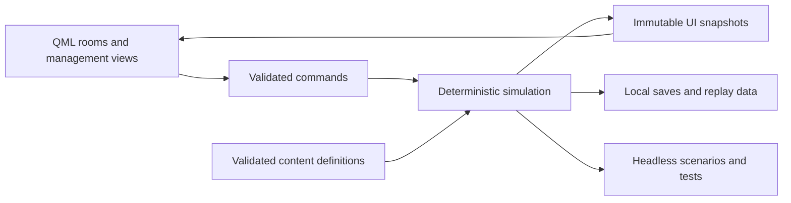

# Technical plan

Baseline 1.2 · 2026-11-03 · Proposed implementation; no game/build system exists yet

## 1. Stack decision

Use **C++20, Qt 6.12.x, Qt Quick/QML, CMake, and Ninja** for a native desktop game. The simulation is a standard C++ library, independent of Qt and the UI. A small headless executable runs scenarios and regression tests. The interface uses Qt Quick Controls, custom QML components, and prepared vector geometry. Use ordinary QML/C++ charts; do not add Qt Graphs, WebEngine, Qt Location, or an embedded browser to the initial dependency set.

This is a design selection based on the data-heavy UI, installed tooling, distribution goals, and a separable long-running simulation. It remains subject to an early packaging/rendering spike. `/opt/Qt/6.12.0/macos/bin/qmake -query QT_VERSION` returned `6.12.0` during planning. That local SDK does not prove other OS packages are available or the game works on them.

| Alternative | Assessment for this project |
| --- | --- |
| Qt Quick + C++ | Selected: maps, comparisons, tables, accessibility hooks, native desktop deployment, and a headless core fit the game. Packaging needs proof. |
| Godot | Viable fallback if native packaging or Qt UI development fails the spike. Better scene tooling; requires a different UI/data integration and build workflow. Do not migrate without a recorded decision. |
| Browser/TypeScript | Good for immediate browser access; introduces browser storage/distribution constraints and a different rendering/build plan. Not needed to satisfy the original desktop-or-browser choice. |
| GameMaker | Installed, but a gameplay-oriented toolchain adds friction to this particular ledger/map-heavy application and native architecture matrix. Not rejected on a claim that it cannot make complex simulations. |
| Ren'Py | Installed, but scene/dialogue strengths are not the main need here. A custom simulation and management UI would still need substantial engineering. Python performance alone is not a sufficient rejection reason. |

Desktop is the primary 1.0 delivery. Browser/WASM is deferred, with no claim it is a free export. Snapcraft follows the complete itch.io release. No Qt license purchase, cloud model subscription, remote GPU, hosted database, or game server is required by the selected architecture.

## 2. Platforms and rendering

The initial qualification matrix is:

| Artifact | Build host | Initial runtime baseline | Rendering policy | Package |
| --- | --- | --- | --- | --- |
| macOS arm64 | Native Apple Silicon GitHub runner | macOS 14.4+ | Metal | `.app` in ZIP; ad-hoc signed, not notarized |
| Linux amd64 | Ubuntu 24.04 x64 | Ubuntu 24.04/glibc 2.39+, compatible GPU/display stack | OpenGL | Portable directory in `.tar.gz` |
| Linux arm64 | Ubuntu 24.04 arm64 | Ubuntu 24.04/glibc 2.39+, compatible GPU/display stack | OpenGL | Portable directory in `.tar.gz` |
| Windows amd64 | Windows x64, MSVC | Windows 11 | OpenGL preferred; Direct3D 11 compatibility fallback | Portable ZIP |
| Windows arm64 | Native Windows ARM64, MSVC | Windows 11 on ARM | OpenGL preferred; Direct3D 11 compatibility fallback | Portable ZIP |

Qt currently defaults to Metal on macOS, Direct3D 11 on Windows, and OpenGL on other desktop platforms; it does **not** automatically choose OpenGL on Windows. Select/test the requested backend explicitly before window construction. A minimal rendering preflight can choose Direct3D 11 on Windows when OpenGL cannot provide a working context; show the active renderer in local diagnostics. This limited compatibility adjustment protects the Windows ARM goal. Linux/Windows software rendering can be an optional recovery mode if it passes UI tests; it is not a substitute for platform qualification. [Qt renderer documentation](https://doc.qt.io/qt-6/qtquick-visualcanvas-scenegraph-renderer.html).

These OS floors follow the selected Qt/toolchain baseline and need confirmation at M0. Qt's platform documentation lists macOS 14.4+, Ubuntu 24.04 ARM/x64, and Windows ARM64 with MSVC. ARM64EC is not the target. Linux bundles are not promised to work on every distribution; glibc, display system, GPU drivers, and essential OS libraries remain host dependencies. [Qt supported platforms](https://doc.qt.io/qt-6/supported-platforms.html).

Use pinned hosted-runner labels after checking current availability and a pinned Qt patch version/checksum. Native ARM runners are available for public repositories; this repository was verified public during planning. Runner availability does not establish usable graphics drivers or physical-device acceptance. [GitHub runner reference](https://docs.github.com/en/actions/reference/runners/github-hosted-runners).

Before writing the matrix, M0-01 records actual Qt archive/module availability for all five targets using repository metadata/`aqt list-qt`, host/target/architecture names, checksums, compiler ABI and acquisition fallback. Keep Qt 6.12.x as the selected baseline. Do not quietly downgrade ARM to distro Qt 6.4 or promise compatibility with every intervening Qt release; that adds an untested API/packaging matrix. If an archive is unavailable, qualify a pinned source build on CI or record a single supported-baseline adjustment with evidence. Avoid unnecessary new APIs where ordinary Qt facilities suffice, without claiming older versions are supported. [aqt inventory commands](https://aqtinstall.readthedocs.io/en/latest/cli.html).

## 3. Intended source structure

The following directories describe future implementation; creating this plan does not create a runnable scaffold.

```text
src/core/            # dates, IDs, units, state, commands, deterministic daily systems
src/persistence/     # save/replay serialization and migrations, no UI dependency
src/content/         # typed definitions, validation, scenario/catalog loading
src/editor/          # separate Content Studio application, repository IO and authoring bridge
src/headless/        # scenario runner, replay and benchmark commands
src/app/             # application lifecycle and dependency wiring
src/bridge/          # Qt models, immutable snapshots, command adapters
qml/                 # rooms, reusable controls, tables, inspectors, accessibility
qml/editor/          # editor-only node canvas, content browser, forms and impact tools
data/                # versioned, validated game definitions, no executable scripts
authoring/           # shareable layouts, fixtures and finalized content history; not game payload
assets/              # licensed local visuals/audio/fonts, provenance and credits
tests/               # unit, deterministic, integration, scenario and migration fixtures
tools/               # small content/build validation tools
cmake/               # dependencies, presets, deployment support
.github/workflows/   # validation and native build/package jobs
docs/                # design, decisions, operating plan, and evidence
agents/              # reusable role briefs and task handoff format
project-versions.json # checked-in component/compatibility versions; planning values initially
```

Dependency direction is `app → bridge/UI + persistence/content → core`; the core has no dependency on Qt, filesystem locations, JSON library types, renderer, audio, or network facilities. Persistence and content may use a pinned permissively licensed JSON library; start with `nlohmann/json` and record its exact version and MIT license at implementation. Qt types terminate at the bridge. Tests can link only the layer they exercise.

The separate `pgp-editor` target depends on the same content compiler/registry/core and selected reusable presentation components. Editor-only Qt/QML, repository writers and graph layout have no reverse dependency from the game. Default builds/package manifests include the game; explicit editor builds create independent artifacts. Its graph, forms and outline share one document model. Do not introduce a browser framework or a second event interpreter to reproduce the node-editor concept.

## 4. State, commands, and UI integration

`GameState` owns the calendar, world profiles, companies, markets, research, model lineage, data rights, sites, policies, objective windows, and RNG streams. Stable typed IDs replace raw cross-entity pointers. Each content reference is validated. Core systems mutate through transactions with named causes, not UI callbacks.

Commands such as `StartTraining`, `OfferContract`, `HireTeam`, `SetBudgetPolicy`, `PublishArtifact`, and `BuildSite` carry explicit arguments and an expected state revision. Validation returns a stable reason code and player-readable explanation. Revalidate on commit: a forecast or screen becoming stale must not spend unavailable cash. An accepted command is recorded with its authoritative order; rejected commands have no partial effect.

The simulation runs on one worker thread. Presentation receives immutable snapshots/diffs at a capped rate (initial target 10 Hz while running, immediate on pause/command result). QML never reads mutable core state or advances time. The main thread remains available for keyboard, menus, dialogs, and rendering. Keep the commit order single-threaded until profiling demonstrates a need for parallel pure calculations.

Bridge collections are persistent `QAbstractItemModel` instances keyed by stable entity IDs. On the GUI thread, diff snapshots, emit `dataChanged` only for changed roles and use insert/remove/move or appropriate layout notifications for structural changes. Routine 10 Hz updates must not replace whole models or reset them. Preserve selection, scroll anchor, expanded rows and keyboard/edit context by ID; use a reset only for a genuinely new collection/campaign and restore valid context deliberately. Coalesce obsolete snapshots without dropping command receipts/required alerts. Verify focus/scroll under live changes and sorting at 200% text scaling. [Qt model contract and thread rules](https://doc.qt.io/qt-6/qabstractitemmodel.html).



Forecast previews run on a copied/summary state without consuming real RNG or mutating the simulation. Preview ranges disclose unknown demand, research outcomes, and hidden rival information; they are not a way to inspect the future's random draws.

## 5. Data and extension model

Use versioned JSON definitions for scenarios, rivals, hardware families, datasets, research nodes, model recipes, products, markets, policies, events, and objective rules. Validate required fields, units, unique IDs, references, graph cycles, ranges, and budget/ownership totals. Keep balance numbers out of QML and narrative prose. Examples in [the examples directory](examples/README.md) illustrate the format; production schemas and loaders are M1 work.

Content flows have ID/revision, typed context, trigger facts, lifecycle, occurrence bounds, ordered effect/event graphs and content tags. News/dialogue presentations, choices/results, hidden rules, delays and continuous modifiers share a restricted expression/effect vocabulary. The graphical compiler produces a bounded normalized runtime representation. Stable registries define facts, scopes, units, operations, tooltips and ports for both editor and game; typed fan-out order and trigger/effect traces are explicit. Never execute arbitrary C++, JavaScript, Python, shell code, or remote content from a scenario/save. Localization keys live separately from mechanics. Material surprises need a traceable causal fact. [Studio contract](CONTENT_EDITOR.md), [runtime rules](SIMULATION_SPEC.md).

The first release ships only reviewed built-in runtime content. Studio authors open a selected source checkout, browse existing data and edit validated repository definitions; drafts/layouts/fixtures/recovery files are excluded from game bundles. Player mod support, external scenario-pack loading, Workshop integration and executable plugins have no commitment in this plan and would need a separate decision. The authoring tool is not a reason to add mod-loading UI or repository writes to the game.

Repository changes use conflict-aware staged batches and journaled multi-file recovery. Content revisions and runtime hashes follow the shared [versioning contract](VERSIONING.md). The Studio stays entirely local, with no telemetry, model service, updater, store credentials, automatic Git push or publishing function. Agents' normal task-end Git preservation remains separate from interactive authoring.

## 6. Save/load, autosave, and campaign history

Use a documented UTF-8 JSON envelope with `.pgpsave` extension for the initial format. Include format version, simulation version, content versions/hashes, seed, date and daily phase cursor, all RNG states, state revision, active commitments, queued event/flow instances and definition revisions, current nodes and bounded continuation frames, committed-effect receipts, cooldowns, owned modifiers, installed market shares, objective accumulators/feasibility alerts, and bounded historical summaries. Encode authoritative integers losslessly; reject unexpected floating-point JSON state. Integrity hashes detect accidental corruption, not hostile tampering or encrypted secrets. Plain-text fictional names are acceptable.

Local preferences and an autosave ring are allowed. Use the platform's standard writable application-data/settings locations, make them discoverable in the UI, and support a portable save location plus Save As/Export. Default: three rotating local autosaves at a completed monthly boundary and before major irreversible in-game commitments. Allow disabling autosaves. Preferences are small, local, and contain no account identity or device identifier. Do not store passwords, collect OS account names, or ask for real personal information.

Writes use a temporary sibling, flush, and atomic replacement where supported; keep the previous valid version until the new file is committed. Never delete a user's original during migration. Validate lengths, counts, type/range constraints, references, and a configurable file-size bound before constructing state. Load errors preserve current play and explain recovery options. Future unsupported formats are refused, not guessed. Experimental pre-1.0 saves can have explicitly announced breaks; stable 1.0 saves require tested migrations in later releases.

A bounded command journal supports debugging/replay when included in a local save. Full developer replays are explicit local exports. Nothing uploads a save or diagnostic file. Campaign history is gameplay state, not an analytics pipeline. Old daily records compact into monthly/yearly summaries while retaining important events and financial totals.

## 7. Privacy and the absence of a backend

The game is entirely self-contained after installation. There is **no publisher-operated game server, runtime API key, player account, telemetry endpoint, analytics SDK, crash uploader, remote AI, advertising SDK, remote font, CDN dependency, cloud save, or in-game updater**. It does not collect player identifiers, hardware fingerprints, location, contacts, or behavioral analytics. Local game state, settings, and saves are the only normal persistence.

Itch's client and Snap handle their own installation/update behavior; they are separate applications/services. The game does not implement a local HTTP server or embed a browser merely to look app-like. A website/store link in the credits opens the system browser only after an explicit click and contains no player/session payload. Credits remain useful without following links.

Developer tooling and CI necessarily fetch dependencies and push artifacts; this does not add networking to the distributed game. A linked framework may contain networking capabilities, but application code and QML must not initiate requests or listen on sockets. Block remote resource URLs in content/loading paths. Verify release behavior with network-denied execution and attempted-connection observation through representative play, not only a search for the word telemetry.

M0-03 installs resource guards before loading either application's QML: a URL interceptor for resolved imports/resources and a custom QML network-manager factory whose manager returns a denied reply without transport for forbidden requests. Returning a null manager is not a defined deny policy. Allow bundled `qrc:` resources, explicitly registered local image providers, and canonical local file roots needed by the product; reject remote schemes, remote file hosts/UNC paths and escapes through symlinks. The game has no general file-resource browser; the Studio additionally permits its selected checkout. Test remote images/fonts/imports and QML requests, blocked redirects and legitimate local loading. These guards cover QML/loading paths, not every possible native socket API; retain the application-wide no-network rule, dependency review and observed-connection tests. Deliberate external credit links remain a separate system-browser action. [URL interceptor](https://doc.qt.io/qt-6/qqmlabstracturlinterceptor.html), [network factory](https://doc.qt.io/qt-6/qqmlnetworkaccessmanagerfactory.html).

Developer diagnostics are compiled out by default using `PGP_DEVELOPER_DIAGNOSTICS=0` and `#if PGP_DEVELOPER_DIAGNOSTICS`, not `#ifdef` on a macro defined as zero. Debug output is local and bounded; diagnostic exports are explicit and inspectable. There is no telemetry implementation to enable in either build type. Do not promise that preprocessor symbols remove framework capabilities or OS-generated crash handling.

## 8. Build command contract

M0/M1 will implement the following commands. They are **not available yet**:

| Command | Required behavior |
| --- | --- |
| `./make.sh` | Configure and compile an optimized Release build, no launch, no upload |
| `./make.sh --debugging` | Explicit developer Debug build with local diagnostic support |
| `./make.sh --debug` | Alias for `--debugging` |
| `./make.sh --core-only` | Build headless/core targets without downloading or requiring Qt |
| `./make.sh --editor` | Explicitly build the separately packaged Content Studio in the selected configuration |
| `./make.sh --all` | Explicitly build both game and editor; never imply a combined game package |
| `./make.sh --test` | Build the selected configuration and run its appropriate tests; propagate failure |
| `./make.sh --package` | Produce a local distributable only when explicitly requested; CI is the normal packaging path |
| `./make.sh --clean` | Remove only known generated directories owned by this build wrapper |
| `./make.sh --help` | Describe flags, dependencies, output paths, and configuration |

`--package` packages the selected product: game by default, editor with `--editor`, separate manifests/artifacts with `--all`. No editor/debug palette, drafts, authoring fixture, recovery journal or layout may enter a base game binary/resource/package. Package the editor independently for the same five native targets, and qualify its repository IO/canvas/help as well as the shared renderer. Existing Qt deployment work is reused, but a passing game package does not certify editor behavior.

Use out-of-source CMake presets under ignored `build/`. Select compiler-appropriate Release optimization, `NDEBUG`, and link-time optimization where tested; do not hardcode GCC's `-O3` into an MSVC build. Keep assertions in test targets even when the application is Release. Debug flags must never silently carry into a later default build. An explicit build preset/output directory identifies configuration.

For macOS Qt builds resolve Clang and the SDK through `xcrun` under one explicitly selected Xcode developer directory, before CMake's first configure. Record both paths/versions and target architecture; do not inherit `/usr/local/bin/clang++` simply from `PATH`. A per-process `DEVELOPER_DIR`/preset may select an existing installation without changing global `xcode-select`. Refuse/reconfigure a cached build using another toolchain. Additional LLVM core-only checks are useful, but do not establish a libc++ conflict merely from a compiler's location; inspect actual link/runtime paths.

Discover the local Qt path through an argument/environment override or a documented local preset. No `/opt/Qt` or developer-home path may remain as a runtime dependency. The core-only path must remain usable on a clean environment with a C++20 compiler, CMake, and Ninja. Dependencies are pinned and documented; no unversioned downloads at runtime or from a player's launch.

## 9. CI, packaging, and publication

On pull requests: validate docs/data/versions, build/test the core across compiler families, and build native game/editor targets as they exist. Before each product's tag/release candidate: run its complete five-artifact native matrix, package from clean staging directories, inspect dependencies, include source/license/credit material and checksums, and run clean-machine smoke tests. Both products share toolchain caches where practical but have separate payload manifests and qualification. Keep artifact/cache retention short; do not store SDKs or binaries in Git. Pin action revisions and dependency versions during implementation.

The checked-in version manifest supplies component versions to build metadata and product-specific tags; content-only changes still require a new game version when shipped. The later game Snap reads that same game version using Snapcraft metadata adoption. It does not use the editor tag/content version as its package version. Format compatibility and event-chain migrations are independent of release labels. [Versioning details](VERSIONING.md).

Deploy Qt libraries, QML imports, accessibility/platform plugins, image support, audio dependencies, and compiler runtime libraries actually needed. Use Qt deployment tooling/CMake deployment APIs, `macdeployqt`, and `windeployqt` where applicable; Linux uses a controlled staging manifest and runtime-path inspection. Bundle required redistributable user-space dependencies. System libc, OS frameworks, and graphics drivers are documented exceptions; never copy arbitrary host libraries until a bundle happens to launch. Qt documents both library and QML deployment requirements. [Qt deployment guide](https://doc.qt.io/qt-6/deployment.html).

Ad-hoc sign the complete macOS bundle after bundling frameworks. No notarization service or paid Apple account is required by the baseline; provide accurate installation instructions and test the actual downloaded artifact. For a trusted blocked download, document Apple's per-app flow: attempt launch, then System Settings → Privacy & Security → Open Anyway when offered. Managed systems can restrict this. Do not promise that Control-click or an itch client bypasses quarantine; test browser ZIP and any supported client route. Never tell players to disable their whole system's security. Windows signing/notarization upgrades can be considered later without changing gameplay or privacy. Do not auto-launch on install or after builds. [Apple's per-app instructions](https://support.apple.com/en-us/102445).

Audio is an optional application adapter, with a silent implementation available to every build. Qt Multimedia is not a required module: it is absent from the installed Qt 6.12.0 SDK checked on 2026-11-03. First probe a small playback-only backend such as pinned `miniaudio` plus `stb_vorbis`, using native device backends and an allowlisted PCM WAV/Ogg Vorbis asset path. Pin versions/hashes/licenses in M0 before adoption; do not vendor a floating branch. Miniaudio includes other decoders by default: explicitly disable unneeded MP3/FLAC/encoding support, restrict accepted WAV encodings and inspect the resulting dependencies. Do not instantiate capture devices. Its floating-point audio processing stays outside authoritative state. Verify playback, mute/volume, device loss, Linux host-library needs and native ARM builds; no unmeasured compile-time or driver guarantee. Qt Multimedia remains a recorded alternative only if its selected backend/dependency inventory is acceptable; FFmpeg is common, not unavoidable in every build. No video cutscenes ship in 1.0. Silence remains a complete slice play mode while audio qualification is pending. Codec choices do not establish worldwide patent freedom. [Miniaudio source/configuration](https://github.com/mackron/miniaudio), [Qt media backends](https://doc.qt.io/qt-6/qtmultimedia-index.html).

Package source archives and the corresponding dependency/license information appropriate to the distributed GPL/LGPL components; preserve third-party license identities. Dynamic Qt linking is the baseline. A repository link alone is not assumed to satisfy every corresponding-source obligation. [Qt open-source obligations](https://www.qt.io/development/open-source-lgpl-obligations).

Seed the dependency register from installed Qt SPDX/CycloneDX SBOMs, then reconcile against the actual deployed libraries/plugins, selected license alternatives and corresponding-source/notice material. An SDK SBOM can include unused tools and alternatives; it is evidence for an inventory, not a blanket clearance or the exact game payload.

Publication is a separate explicit release task. A normal documentation/code push does not authorize publishing an itch page, uploading a public game build, configuring paid services, or submitting Snap packages. There is no in-game release channel or update check. Snap manifests and store submission are deferred until the primary desktop packages pass release gates.

## 10. Performance and delivery risks

Initial measurement targets: UI response to ordinary actions <100 ms; 60 fps on the declared minimum GPU with 30 fps recovery on low-power systems; peak working memory <1 GB for the standard 100-year campaign; saves <25 MB after normal history compaction; save/load <2 seconds on a reference SSD; headless 100-year run <60 seconds on a modern development CPU. These are targets, not measured results. Record named hardware/configuration, entity counts, and actual percentiles before publishing minimum requirements.

Largest risks are platform packaging (especially ARM graphics/audio), explaining a complex simulation, boring century-scale repetition, political/economic oversimplification, authoring-tool complexity, unbounded feature growth, and save compatibility. M0 proves the toolchain/version path; E1a proves useful forms/outline/inspection before slice content; M3 proves one enjoyable loop; E1b completes the required node canvas/finalizer and author study before M4; E2 expands authoring before M8 campaign endurance; M9 proves game distribution. Failed gates result in a scoped fix or a recorded product decision, never a false claim of platform support.
