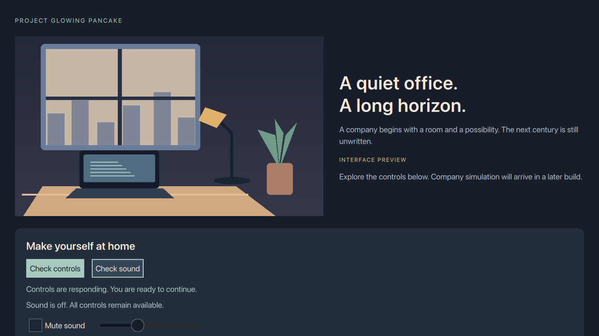

# M0-03 — Local interface and resource probe

Observed 2026-11-03 on the native arm64 Mac, Apple Clang 21/SDK 27.3 and Qt 6.12.0
recorded in [M0-01](M0-01-toolchain.md). **M0-03 remains in progress**: native
Windows/Linux rendering, relocated deployment and physical audio/device-loss
qualification have not been performed.

## Implemented slice

`pgp-probe` is a development executable with original procedural office art,
bundled PNG/JPEG fixtures, keyboard-accessible controls and optional sound. It
labels itself an interface preview; there is no company simulation or save.
Application wiring/controller, QML presentation and graphics/resources/audio
are separate targets/files. Neither core nor headless links these targets or Qt.

QML/images/audio fixtures are embedded; no checkout asset path is required at
runtime. Sound extraction into an owned temporary directory happens only after
button activation. Native audio is opt-in; the default build is silent. See
[audio evidence](M0-03-audio.md) for pinned sources, licenses, limits and checks.
Build/install never launches the app or plays audio.

The explicit `--smoke-test`, `--screenshot` and `--text-scale` commands belong to
this development probe, including Release. It is not a released game or evidence
of the final game's developer-control exclusion. Core Release still compiles
with `PGP_DEVELOPER_DIAGNOSTICS=0`.

## Resource policy

An immutable allowlist is shared by an engine-owned URL interceptor and network
factory, installed before loading QML. The app permits `/pgp/`, Qt's two bundled
import prefixes and the canonical installed Qt QML directory. Its import path
list excludes arbitrary working-directory/home roots. The reusable policy also
supports selected local roots and exact registered image-provider identifiers.

Remote schemes, file authorities/UNC, unknown providers and canonical
parent/symlink escapes are refused. Approved local GET/HEAD receives an
asynchronous read-only `QFile` reply; other requests receive asynchronous denial.
The manager never calls the base transport implementation. Redirect policy is
manual and cannot be overridden per request; there is no HTTP response/redirect,
DNS, proxy or socket transport path in this manager. Tests contact no endpoint
and open no listener. This guards QML paths, not arbitrary native sockets or the
whole process; the final attempted-connection/privacy audit remains required.

## Verification

| Check | Actual result |
| --- | --- |
| Desktop Release and Debug `make.sh --test` | 10/10 CTests pass in each configuration |
| Separate native-audio Release | 10/10 pass; explicit Core Audio playback completed |
| Core-only Release | 5/5 pass; only system libc++/libSystem runtime linkage |
| Explicit Metal smoke, 1280×720, 100% and 200% text | Both pass: PNG/JPEG ready, Space activation, Tab order, accessible name, focused-control visibility and sound-button fixture loading |
| Explicit offscreen software smoke | Same checks pass on this Mac |
| Actual QML loading | Bundled/local PNG/QML and trusted provider work; remote image/font/XHR/QML/import, unknown provider and file/symlink escape fail |
| Network-manager tests | Async approved bytes work; remote/UNC/local writes denied; redirect override refused |
| Graphics policy tests | Mac Metal, Linux OpenGL, injected Windows OpenGL success/D3D11 recovery outcomes pass |
| Probe CLI failures | NaN scale and screenshot without smoke refused before creating a window |
| Native-audio app smoke | Same Metal/input/fixture checks pass through the actual sound-button activation path |
| Independent source review | Corrected NaN validation; checked setup order, guard lifetimes and target boundaries |

Large text initially allowed keyboard focus below the visible viewport. The
view now reveals the focused control by scrolling; smoke tests verify visible
geometry. The application's tab policy includes all controls on Mac. This checks
keyboard/name behavior, not VoiceOver or full reader support. 200% here means
text scaling, not qualification of every OS DPI setting.

## Dependency evidence and remaining gates

The import scanner reported QML, QtQml (Models/WorkerScript), QtQuick,
Controls.Basic, Controls.Basic.impl, Controls.impl, Layouts, Shapes and Templates.
The development executable links Qt Core/Network/Qml/Gui/OpenGL/Quick/Controls2
and system frameworks. The installed optional QmlAssetDownloaderPrivate CMake
package still warns about missing TaskTree; the selected imports exclude it and
the actual UI renders without it. No warning was suppressed or SDK downloaded.
Development-SDK import/link evidence is not an exact relocated payload/license
clearance; reconcile the deployed closure against the M0-01 SBOM register later.

Windows OpenGL context/current-surface preflight is implemented before selecting
Qt Quick; failure selects D3D11. Native Windows rendering of both paths and Linux
OpenGL are untested. Injected policy results do not prove native driver behavior.
Later scene-graph initialization failure exits with a diagnostic; recovery from
every driver failure after successful preflight is not claimed.

No clean deployed package, signing/quarantine, real cable/device removal, human
listening or full privacy/reader audit was completed. Finish M0-03's native and
deployed-closure evidence before closing its checkbox and M0-04's five package
probes. M0-05 remains independently unblocked. Component placeholders are
unchanged; no product release or publication occurred.

API choices follow Qt's [renderer interface](https://doc.qt.io/qt-6/qsgrendererinterface.html),
[OpenGL context](https://doc.qt.io/qt-6/qopenglcontext.html),
[graphics configuration](https://doc.qt.io/qt-6/qquickgraphicsconfiguration.html),
[QML interceptor](https://doc.qt.io/qt-6/qqmlabstracturlinterceptor.html),
[network factory](https://doc.qt.io/qt-6/qqmlnetworkaccessmanagerfactory.html)
and [resource deployment](https://doc.qt.io/qt-6/qtquick-deployment.html) contracts.
